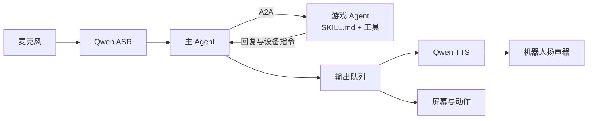

<p align="center"></p>

<h1 align="center">Agentcade</h1>

<p align="center">
  <a href="https://huggingface.co/spaces/left0ver/WatcherRobot-com.left0ver.agentcade"></a>
  
  
  
  
  <a href="LICENSE"></a>
</p>

<p align="center">让桌面机器人“小懒”陪你聊天、玩游戏，全程用嘴说就行。</p>

小懒就是主 Agent，负责聊天和选游戏；每个游戏是一个独立的游戏 Agent，小懒通过 A2A 和它们通信。游戏可以内置在应用里，也可以由任何人部署在自己的服务器上，用户粘贴地址就能安装。

## 设计理念

- **主 Agent 和游戏 Agent 只靠消息通信**：小懒把用户的话转给游戏，消息分开局、局内输入、结束三种；游戏回一条或多条消息，每条是要说的话和要机器人执行的设备指令。双方用 A2A 流式通信，协议是 `agentcade/1`。游戏的规则和状态都留在游戏里，小懒不用理解，所以内置游戏和远程游戏走同一套协议，用任何语言实现这个协议都能接入。
- **游戏 Agent 由 SKILL.md 和工具驱动**：每个游戏是一个 ReAct Agent。`SKILL.md` 用自然语言写规则和主持流程，`agent.py` 提供出题、判定、计分这些工具。每收到一条消息，大模型对照游戏说明和当前状态，自己决定调用哪些工具、说什么；题目、对错和得分只来自工具的结果。
- **游戏开放，权限收紧**：游戏可以用任何语言实现、部署在任意服务器上，但不直接访问设备。游戏对机器人的操作以设备指令的形式随回复交给主 Agent，主 Agent 逐条校验：方法在白名单内、参数符合 SDK 签名、所需能力已经授权（远程游戏安装时由用户逐项授权，新增能力要重新授权），校验通过才执行。麦克风、摄像头等涉及隐私的接口不对游戏开放。

## 快速开始

### 1. 安装依赖

```bash
git clone https://github.com/left0ver/agentcade.git
cd agentcade
uv sync          # 创建 .venv，安装依赖和 WatcheRobot SDK
```

### 2. 连接机器人

第一次使用时运行，之后不用再运行：

```bash
uv run watcherobot robot setup     # 通过蓝牙给机器人配网，再和电脑配对
uv run watcherobot robot status    # 确认机器人已经连上
```

按提示选择机器人、输入 Wi-Fi，再输入机器人屏幕上显示的六位配对码。机器人要和电脑在同一个局域网里。

### 3. 启动

```bash
uv run watcherobot app run .       # 按 Ctrl+C 停止
```

第一次启动时还没有密钥，浏览器会自动打开设置页面 `http://127.0.0.1:8790/settings`。在“服务配置”里填好下面三个 API Key 并保存，应用会自动继续启动，不用重新运行命令：

| API Key | 用来做什么 | 填在哪一栏 |
| --- | --- | --- |
| 阿里云百炼（DashScope） | 语音识别和语音合成 | 主 Agent |
| 大模型（OpenAI 兼容接口，默认 DeepSeek） | 聊天、选游戏、主持游戏 | 主 Agent 和每个游戏 |
| Typesafe | 判断你画我猜的答案、回答海龟汤的提问 | 你画我猜和海龟汤 |

### 4. 操作

全程对着机器人说话就行。小懒说话时不听，等它说完再开口。

| 对小懒说 | 会发生什么 |
| --- | --- |
| “有哪些游戏” | 介绍可以玩的游戏 |
| “玩你画我猜”“玩海龟汤” | 开始一局，具体怎么玩小懒会在开局时讲 |
| “结束游戏” | 结束这一局；想换游戏要先结束当前这一局 |

浏览器里有两个页面：

- **对话页面** `http://127.0.0.1:8790`：实时显示识别结果、小懒的回复、工具调用和机器人的动作，听不清或者没反应时先看这里。
- **设置页面** `http://127.0.0.1:8790/settings`：
  - “服务配置”：改密钥、模型和音色，保存后重启应用生效。
  - “游戏”：启用、停用、卸载游戏，从“发现更多游戏”里安装，或者粘贴别人部署的游戏地址安装，改动马上生效。安装远程游戏时要确认它能让机器人做什么。

> [!NOTE]
> 连续玩一个多小时后，机器人可能听不到声音或者屏幕不再变化（固件每开关一次麦克风会少一点内存），断电重启就好。

## 本地开发

本地开发时也可以不用设置页面，把密钥直接写在源码目录的 `.env` 里。目录里有 `.env` 时应用读它，没有时才读用户配置目录：

```bash
cp src/agentcade/.env.example src/agentcade/.env                 # 主 Agent 的密钥
cp src/games/guess_animal/.env.example src/games/guess_animal/.env
cp src/games/turtle_soup/.env.example src/games/turtle_soup/.env
```

常用命令：

```bash
uv run ruff check app.py src scripts templates   # 代码检查
uv run watcherobot app check .                   # 检查 app.json、依赖和源码能不能发布
uv run python scripts/e2e_robot.py               # 真机端到端测试，约 5 分钟
uv run python -m games.turtle_soup.generator --count 3 --save   # 提前生成海龟汤的题
```

端到端测试用电脑扬声器替你说话，测试前把机器人放在扬声器旁边，保持安静；结果保存在 `.artifacts/e2e/`。

**配置**：主 Agent 和每个游戏读取哪些配置项，声明在各自目录的 `settings.yaml` 里。改了 `settings.yaml` 后运行 `uv run python scripts/write_env_examples.py` 重新生成 `.env.example`。

## 开发游戏

一个游戏只要两个文件：`SKILL.md` 写游戏声明和主持流程，`agent.py` 提供工具。

- **内置游戏**：放在 `src/games/<游戏 ID>/`，重启应用就会自动接入。
- **远程游戏**：部署在你自己的服务器上，用户粘贴地址就能安装，不用重启。从模板 [`templates/riddle/`](templates/riddle) 开始。

不连机器人也能调试：

```bash
uv run agentcade-game chat src/games/turtle_soup    # 打字和游戏对话
uv run agentcade-game check src/games/turtle_soup   # 合规检查：真实玩一局
uv run agentcade-game play                          # 经过主 Agent，打字玩所有游戏
```

怎么写、怎么测试、要满足哪些要求，见 **[游戏开发指南](docs/game-development.md)**。想让别人在“发现更多游戏”里看到你的远程游戏，按 [`catalog/README.md`](catalog/README.md) 提交到游戏目录。

## 架构



| 部分 | 代码 | 做什么 |
| --- | --- | --- |
| 主 Agent | `src/agentcade/main_agent.py` | 直接聊天，或者用 `list_games`、`start_game`、`end_game`、`send_message` 四个工具管理游戏 |
| 游戏 Agent | `src/agentcade/skill_agent.py` | 按 `SKILL.md` 主持游戏的 ReAct Agent，规则、状态和判定都在游戏里 |
| 通信协议 `agentcade/1` | `src/agentcade/protocol.py` | 基于 A2A：主 Agent 发一条用户输入，游戏回复一条或多条要说的话和设备指令，格式见[开发指南](docs/game-development.md#不用-python-写) |
| 设备指令 | `src/agentcade/robot_calls.py` | 游戏不直接连机器人，`self.robot` 的调用随回复发给主 Agent，检查权限后在机器人上执行，一局结束后复位 |
| 对话页面 | `src/observability/` | `http://127.0.0.1:8790` 实时显示识别结果、工具调用、A2A 消息和设备输出 |

运行中麦克风、语音服务或者大模型出现单次故障时，会自动重试或跳过这一步，不会退出；只有启动时的问题（配置缺失、机器人没连上、端口被占用）才会退出。

## 发布

```bash
uv run publish            # 把源码发布到 Hugging Face，发布前会确认
uv run publish --submit   # 发布后提交到应用广场审核
```

源码发到你名下的公开仓库 `WatcherRobot-<应用 ID>`，审核通过后应用才会出现在应用广场。发布前先改 `app.json` 里的 `version`；加上 `--provider gitee` 改发到 Gitee；`.env` 和 `.watcherignore` 里列出的文件不会发布。

## License

[MIT](LICENSE)
