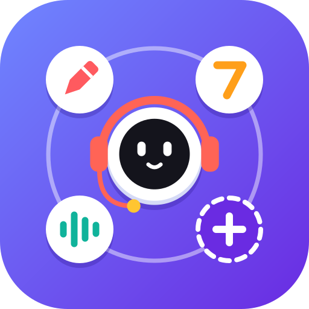
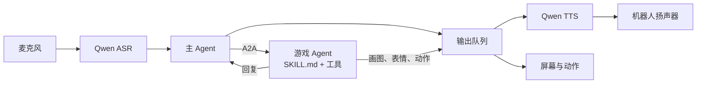

<p align="center"></p>

<h1 align="center">Agentcade</h1>

<p align="center">
  <a href="https://huggingface.co/spaces/left0ver/WatcherRobot-com.left0ver.agentcade"></a>
  
  
  
  
  <a href="LICENSE"></a>
</p>

桌面机器人“小懒”：用语音和它聊天、玩小游戏。主 Agent 负责聊天和选择游戏，每个游戏是一个独立的 Agent，通过 A2A 通信。现在有“你画我猜”、“猜数字”和“海龟汤”，往 `src/games/` 里放一个目录就能加一个新游戏。

## 怎么玩

说“有哪些游戏”查看游戏，说“玩猜数字”开始，说“结束游戏”退出。游戏中可以随时聊天，同一时间只能玩一个游戏，想换游戏要先结束当前这一局。机器人说话时不收音，说完再开口。

- **你画我猜**：机器人在屏幕上画一种动物，你来猜。每局 5 题，每题 2 次机会。说“提示”要线索，不占机会；说“跳过”公布答案并直接画下一题；一题答完后说“下一题”继续。画一题要等几十秒，这段时间可以聊天。
- **猜数字**：机器人想一个 1 到 20 的整数，你有五次机会，每次会告诉你大了还是小了，说“提示”可以知道是奇数还是偶数。
- **海龟汤**：机器人讲一个离奇的小故事，你只能问“是不是”的问题，机器人点头、摇头或者说无关，帮你一步步推理出真相。想明白了就把推理说出来；说“提示”要线索，说“公布答案”放弃这一道，说“再来一道”换题。玩过的题不会重复出，题库里的都玩过了，机器人会现场出一道新题，要等一两分钟。

## 安装后第一次使用

从应用广场安装并启动后，浏览器会自动打开设置页面 `http://127.0.0.1:8790/settings`。填好下面三样密钥并保存，应用就会自动继续启动：

| 密钥 | 用途 | 填在哪一栏 |
| --- | --- | --- |
| 阿里云百炼（DashScope）的 API Key | 语音识别和语音合成 | 主 Agent |
| 大模型的 API Key（OpenAI 兼容接口，默认 DeepSeek） | 聊天、选择游戏、主持游戏 | 主 Agent 和每个游戏 |
| Typesafe 的 API Key | 判断你画我猜答得对不对、按海龟汤的汤底回答提问 | 你画我猜和海龟汤 |

密钥只保存在本机，这些服务按各自的账号计费。打开 `http://127.0.0.1:8790` 可以看到对话内容和每轮用了哪些工具。

> [!NOTE]
> 机器人固件每开关一次麦克风都会少一点内存，连续玩一个多小时后，机器人会听不到声音或者屏幕不再变化，断电重启就能恢复。目前只在 macOS 上验证过。

## 本地开发

需要 Python 3.11+、[uv](https://docs.astral.sh/uv/)，以及一台和电脑在同一局域网的机器人。

```bash
cp src/agentcade/.env.example src/agentcade/.env
cp src/games/guess_animal/.env.example src/games/guess_animal/.env
cp src/games/guess_number/.env.example src/games/guess_number/.env
cp src/games/turtle_soup/.env.example src/games/turtle_soup/.env
# 分别填写这几个文件
uv sync
uv run watcherobot robot setup    # 仅首次连接机器人
uv run watcherobot app run .      # Ctrl+C 或 uv run watcherobot app stop 停止
```

检查和真机测试：

```bash
uv run ruff check app.py src scripts
uv run watcherobot app check .
uv run python scripts/e2e_robot.py   # 用电脑扬声器替用户说话，约 5 分钟
```

运行端到端测试前，把机器人放在电脑扬声器旁边，并保持环境安静。测试会调用真实的语音和模型服务，结果保存在 `.artifacts/e2e/` 下。

海龟汤的题可以提前批量生成：`uv run python -m games.turtle_soup.generator --count 3 --save`。生成的题和玩过的记录保存在 `~/Library/Application Support/watcherobot/applications/<应用 ID>/data/turtle_soup/`。

## 配置

主 Agent 和每个游戏各有一份配置，互不共用。每个 Agent 读取哪些配置项，声明在它自己目录的 `settings.yaml` 里，设置页面的表单、默认值和必填检查都按这份文件来：

```yaml
options:
  - key: JEV_MODEL          # 环境变量名
    label: 判题模型          # 设置页面上的说明
    default: "jev-latest"   # 不写表示必填
    secret: false           # true 表示密钥，页面上不回显
    advanced: true          # true 表示收在“更多设置”里
```

配置的值从两个地方之一读取：

- **本地开发**：从 Agent 目录里的 `.env` 读取。
- **安装后的应用**：从 `~/Library/Application Support/watcherobot/applications/<应用 ID>/config/` 读取，这里的文件由设置页面写入，升级或重装应用都不会丢。

改了 `settings.yaml` 之后，运行 `uv run python scripts/write_env_examples.py`，重新生成各目录的 `.env.example`。大模型的接口要兼容 OpenAI，并且支持 JSON 输出和 function calling。改完配置要重启应用才生效。

## 添加游戏

在 `src/games/<game_id>/` 下新建一个目录，重启应用就会自动接入，不用改主 Agent。可以参考 `src/games/guess_number/` 这个完整示例。

| 文件 | 内容 |
| --- | --- |
| `SKILL.md` | frontmatter 声明 `id`（和目录名一致）、`name`、`aliases`、`description`、`summary`、`required_capabilities`；正文写规则和流程。`summary` 是一句简短介绍，开机问候时跟在游戏名后面念出来 |
| `agent.py` | 入口类 `GameAgent`，继承 `SkillAgent`，实现下面几个方法 |
| `settings.yaml` | 这个游戏读取的配置项 |
| `config.py` | 配置类，继承 `AgentSettings`，需要包含 `llm: LLMSettings` |
| `__init__.py` | 空文件 |

`GameAgent` 要实现：

| 成员 | 作用 |
| --- | --- |
| `skill`、`config` | 游戏声明（`Skill.load(...)`），以及配置类 |
| `tools(turn)` | 返回游戏工具。`turn.text` 是用户原话，`await turn.say(text)` 立刻说一句话，`turn.end_session()` 结束本局 |
| `state()` | 当前状态，每轮写进提示词，不能包含没揭晓的答案 |
| `await self.react(expression, gesture)` | 判定对错时触发表情和动作，比如 `("happy", "nod")` |

游戏用到新的 Python 依赖时，要同时加到 `pyproject.toml` 和 `app.json` 里。如果游戏独立部署在别的地方，在 `games.json` 里登记它的地址，例如 `[{"kind":"remote","id":"my_game","url":"https://example.com"}]`，并按下面的通信格式收发消息。

## 发布

```bash
uv run publish            # 发布源码到 Hugging Face（没登录时先登录），发布前会确认
uv run publish --submit   # 发布后提交到官方名单审核
```

加上 `--provider gitee` 改为发布到 Gitee。源码会发布到你名下的公开仓库 `WatcherRobot-<应用 ID>`，官方审核合并后，应用才会出现在应用广场。`.env` 和 `.watcherignore` 里列出的文件不会发布。每次更新前先改 `app.json` 里的 `version`。

## 架构



- **主 Agent**（`src/agentcade/main_agent.py`）根据用户原话，要么直接聊天回答，要么调用 `list_games`、`start_game`、`end_game`、`send_message` 这四个工具。游戏列表在启动时从 `src/games/` 自动发现。
- **游戏 Agent**（`src/agentcade/skill_agent.py`）是由 `SKILL.md` 驱动的 ReAct Agent。规则、状态、判定和设备操作都在游戏内部，主 Agent 只知道当前在玩哪个游戏。
- **通信格式 `desktop-game/5`**（`src/agentcade/protocol.py`）：主 Agent 发一条用户输入，游戏回复一条或多条要播报的话。消息放在 A2A DataPart 里；Agent Card 要声明 `streaming=true`，skill 的标签包含 `desktop-game/5`，skill 的 `description` 是开机问候里念的简短介绍。

  | 方向 | 内容 | A2A 载体 |
  | --- | --- | --- |
  | 主 → 游戏 | `{"kind": "start\|message\|end", "text": 用户原话}` | 流式 `SendMessage`，`context_id` 标识一局游戏 |
  | 游戏 → 主 | `{"text": 要播报的话, "session": "active\|ended"}` | 中间回复的状态是 `working`，最后一条是 `completed` |

- **运行时容错**：麦克风、识别服务、语音合成、模型调用出现单次故障时，会自动重试或跳过这一步，程序继续运行。只有启动阶段的问题（配置缺失、机器人未连接、端口被占用）会直接退出。
- **对话页面**（`src/observability/`）：本机 `8790` 端口提供“对话”和“轨迹”两个视图，实时显示每一轮的识别结果、工具调用、A2A 消息和设备输出。

## License

[MIT](LICENSE)
