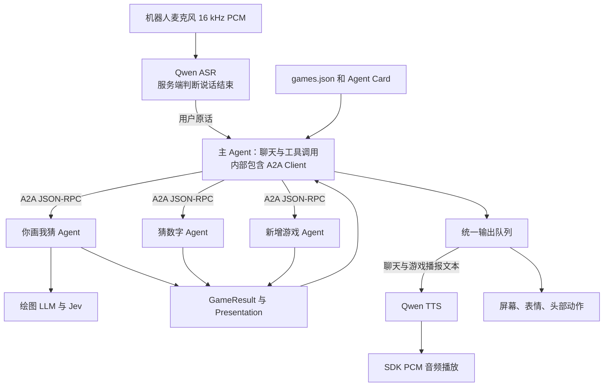

# 桌面机器人 Agent

主 Agent 负责语音聊天和游戏选择，通过 A2A 与独立游戏 Agent 通信。目前提供“你画我猜”和“猜数字”，游戏目录由 `games.json` 配置。

说“有哪些游戏”查看目录，说“开始猜数字”或“玩第二个”选择游戏。游戏期间可以聊天，也可以直接继续回答；说“继续游戏”查询当前进度。等待用户输入期间保持游戏状态。

同时只能运行一个游戏。说“结束游戏”退出，结束播报和设备操作完成后才能开始其他游戏。直接要求换游戏时，机器人会提示先退出当前游戏。

## 你画我猜

对机器人说“我们来玩你画我猜”开始。

- 每局 5 题，每题 2 次机会，答对得 1 分，同一局动物不重复
- 最近 72 小时出现过的动物、同义名称和相同图案不会重复，满 72 小时后可以再次出题；重启程序后仍然保留有效历史
- 答对时点头，答错时摇头，动作与反馈语音同时进行，完成后回到居中姿态
- 说“提示”要线索，每题 3 条，不占机会；第一次答错也会给一条
- 答题结束后说“下一题”继续；答题期间说“下一题”跳过，说“结束游戏”退出
- 画图要等一会儿，这段时间可以随便聊天，聊天不算答题

机器人说话和执行答题反馈动作时不收音，语音与动作都完成后恢复收音。

## 猜数字

机器人随机选择 1 到 20 的整数，玩家有五次回答机会。回答后会告知数字过大或过小；说“提示”可以获得奇偶信息。答对或机会用完后结束，也可以随时说“结束游戏”。

## 运行

需要 Python 3.11+、[uv](https://docs.astral.sh/uv/)，以及一台和电脑在同一局域网的机器人，固件支持 `expression.runtime.v3`、`expression.vector_accessory.v1`、`microphone`、`audio.stream`、`motion`。

```bash
cp robot_agents/.env.example robot_agents/.env
cp games/guess_animal/.env.example games/guess_animal/.env
cp games/guess_number/.env.example games/guess_number/.env
# 分别填写三个文件中的配置
uv sync
uv run watcherobot robot setup    # 仅首次连接设备
uv run watcherobot app run .
```

按 Ctrl+C 或执行 `uv run watcherobot app stop` 停止。

## 配置

每个 Agent 从自己目录中的 `.env` 读取配置，对应目录提供 `.env.example`。文件必须存在；读取时不修改进程环境，不读取根目录 `.env`，也不使用同名进程环境变量覆盖。配置值按字面读取，不展开 `${...}`。

| 配置文件 | 用途 |
| --- | --- |
| `robot_agents/.env` | 主 Agent 的文字 LLM、工具调用、ASR、TTS、音色和游戏目录路径 |
| `games/guess_animal/.env` | 绘图模型、Jev、置信度和预计绘图时间 |
| `games/guess_number/.env` | 猜数字语义理解模型 |

| 变量 | 用途 |
| --- | --- |
| `DASHSCOPE_API_KEY` | 主 Agent 的 Qwen ASR/TTS 接口凭据 |
| `QWEN_ASR_MODEL` | 默认 `qwen-audio-3.1-asr-flash-streaming`，持续识别用户语音 |
| `QWEN_TTS_MODEL` | 默认 `qwen-audio-3.1-tts-flash`，合成聊天和游戏播报 |
| `QWEN_TTS_VOICE` | TTS 音色，默认 `yuxiaoyun_v3.1` |
| `SPEECH_TIMEOUT_SECONDS` | 单次语音合成最长等待秒数，默认 90 |
| `ASR_SILENCE_MS` | ASR 判定说话结束的静音时间，默认 800 毫秒 |
| `ASR_INPUT_GAIN` | 麦克风 PCM 输入增益，默认 4，范围 1 至 8；通过 FFmpeg volume 处理，保持采样率和时间信息 |
| `TYPESAFE_API_KEY` | 你画我猜的 JEV 答案判定凭据 |
| `JEV_MODEL` / `JEV_CONFIDENCE_THRESHOLD` | 你画我猜的 JEV 模型与判定置信度，默认 `jev-latest` / `0.65` |
| `LLM_API_KEY` | 当前配置文件所属 Agent 的 OpenAI 兼容接口凭据 |
| `GAME_CATALOG` | 主程序的游戏目录路径，默认项目中的 `games.json`；相对路径以主程序 `.env` 所在目录为基准 |
| `OBSERVABILITY_PORT` | 可观测性页面的本机端口，默认 8790；不能使用 SDK 守护进程占用的 8765 和 8767 |

`DASHSCOPE_BASE_URL` 是百炼业务空间的地址，换 key 时记得一起改。

## 文字模型

主 Agent 和游戏 Agent 各自在自己的 `.env` 中设置 `LLM_MODEL_NAME`、`LLM_BASE_URL`、`LLM_API_KEY` 和请求参数。相同键名在不同文件中互不影响，运行时不会读取其他 Agent 的配置。全部 LLM 调用通过 OpenAI SDK 访问兼容 Chat Completions 的接口，使用原生 function calling 执行注册工具。主 Agent 的普通聊天回复直接交给 TTS。

OpenAI 兼容接口在对应 Agent 的配置文件中填写，例如：

```dotenv
LLM_BASE_URL=https://api.deepseek.com
LLM_API_KEY=填写你的密钥
LLM_MODEL_NAME=deepseek-flash
LLM_EXTRA_BODY_JSON={"thinking":{"type":"enabled"},"reasoning_effort":"low"}
```

更换服务时，将 `LLM_BASE_URL`、`LLM_API_KEY`、`LLM_MODEL_NAME` 改成目标服务的配置。这三项必须填写，接口需要支持 JSON 对象输出和 function calling。`LLM_EXTRA_BODY_JSON` 默认是 `{}`，用于填写所选服务支持的可选参数，如思考模式、输出长度或服务等级。它不能覆盖模型、消息、响应格式、流式模式或工具参数。`LLM_TIMEOUT_SECONDS` 控制单次调用超时，默认 180 秒。

修改配置后重新启动应用。本地游戏的 A2A 等待时间为该游戏的模型超时加 30 秒。远程游戏在 `games.json` 中单独配置 `timeout_seconds`，默认 210 秒。

生成失败或超时会直接报错。每次生成的 JSON 和去重记录存在 `.artifacts/`，重启后仍然有效。

你画我猜的生成提示词要求模型优先选择常见动物，并使用常用、容易读写的名称和别名，避免名称中含有不常见的生僻字。

## 可观测性

应用运行期间打开 `http://127.0.0.1:8790` 查看实时轨迹，端口由 `OBSERVABILITY_PORT` 设置，服务只监听本机。端口上已有其他服务时应用启动失败并提示修改端口。页面按轮次列出四类记录，点击任意一行在右侧查看完整输入和输出：

| 记录 | 内容 |
| --- | --- |
| 用户 | ASR 的最终识别文字，每条开启一轮 |
| 主 Agent · 回复 | 主 Agent 不经过游戏、直接回复用户的文字；游戏播报在 A2A 结果中 |
| 主 Agent · 工具、游戏 Agent · 工具 | 各自发起的工具调用，包含完整参数、返回或错误、耗时 |
| A2A →、A2A ← | 主 Agent 发给游戏的 `GameRequest`，以及游戏返回的进度消息和最终 `GameResult` |

游戏结果中带有图案时，检查器按机器人屏幕的样式把它画出来。检查器底部的关联记录列出上级和下级，点击即可跳转。一次 A2A 请求及其引发的游戏侧工具调用归入发起它的那一轮，图案生成这类较晚返回的结果也归回原来那一轮。程序退出时自动发送的 `end` 显示在“轮次之间”。远程游戏只显示 A2A 请求和结果。

事件只保存在内存中，保留最近 2000 条，重启后清空；不保存录音，也不写入磁盘。页面最多显示最近 3000 条记录，断线后保留已收到的记录并自动重连，应用重启后在原记录之后继续显示新的运行。事件包含对话内容，不包含密钥。

每一轮的标题显示从用户说完到最后一条记录的耗时，时间线一列画出各条记录在这一轮中的起止位置：工具调用和 A2A 请求是时间段，其余记录是时间点。页面顶部可以搜索记录、收起或展开全部轮次；收起后每轮显示用户原话和记录条数。上下方向键切换选中的记录。

## 检查

```bash
uv run ruff check app.py robot_agents games observability scripts
uv run watcherobot app check .
```

目前没有自动化测试。`uv run watcherobot app run scripts/eye_preview` 可以在真机上逐个预览眼型，不调用模型。

## 实现



主 Agent 使用持续的 ASR WebSocket 会话识别麦克风语音，由 ASR 服务判定说话结束。识别结果携带说话开始时间，用于关联当时的游戏会话和题目版本。主 Agent 根据原话、历史、当前游戏状态和期望的下一步输入，调用 `list_games`、`start_game`、`end_game`、`send_message`。每轮模型调用都会将当前已注册游戏的名称、ID、别名和介绍按目录顺序写入系统提示词，新增游戏通过注册即可使用。普通聊天由主 Agent 直接回复，游戏介绍和播报使用简短的日常口语。

游戏 Agent 负责规则、题目、提示、答案判定、计分和正常结束条件。游戏返回的播报原文进入输出队列，与聊天回复统一交给 TTS 合成音频。聊天期间游戏会话、题目和回答次数保持不变，后续游戏输入直接交给当前游戏。用户说“继续游戏”时，游戏返回当前进度。等待用户输入期间没有计时提醒、机会扣除或自动结束；网络请求超时继续作为通信异常处理。

每个游戏注册自己的模型工具，通过 `send_message` 交付操作反馈。每次 A2A JSON 回复必须包含 `state` 和 `expected_input`；主 Agent 保存这些字段供后续模型调用使用。完整工具名称、参数和消息示例见 [通信设计](docs/main-agent-game-a2a-design.md)。

本地游戏通过官方 `a2a-sdk` 启动仅监听 `127.0.0.1` 的 HTTP 服务，并通过 Agent Card 发现。请求通过 A2A Task 执行，游戏 Agent 可以在流式状态消息中发送进度和展示内容，完成时通过 artifact 交付结果，退出时取消进行中的任务。`context_id` 标识一局游戏，`request_id` 用于请求去重，`revision` 拒绝已经过期的题目输入。主 Agent 在输出完成前保留当前游戏的占用状态。

- **图案**：模型输出动物名、别名、3 条提示和笔画坐标，经 Pydantic 校验后用 SDK 的矢量配件逐笔显示。设备上限是 12 条笔画、192 个点。重名、提示里带答案、笔画和以前完全相同的结果都会被拒绝。
- **表情**：`robot_agents/assets/emojis/` 里的三个 SVG 转成白色矢量笔画，分别用于生成中、答对、答错。生成中的进度条分成十格，按 `DRAWING_ESTIMATE_SECONDS` 估算，每经过预计时间的十分之一增加一格，等待结果时最多显示九格。生成完成后显示满格，再绘制动物。每次进度变化使用 `expression_runtime.start()` 提交完整图案和显示参数，一次生成最多提交 11 个进度画面。`ProgressDisplay` 管理计时和任务标识，显示命令串行执行，退出后旧进度请求失效。
- **语音**：接收 TTS 返回的 24 kHz、单声道、16-bit PCM，完整响应收齐后通过 SDK `audio.play_pcm()` 播放。所有播报排队，互不打断；取消时停止设备播放。当前采用半双工交互，输入处理和播报流程分别登记麦克风暂停请求，全部释放后才恢复收音。暂停期间向 ASR 发送静音，涉及暂停音频的识别结果会被忽略。
- **设备连接**：`DeviceContext` 等待 `sys.sdk.ready.get` 确认与 `evt.sdk.ready` 能力信息后完成启动。麦克风收到第一段 PCM 后才标记为可以收音；连续两秒没有 PCM 时，异常包含会话 ID、最后序号、接收字节数和解码状态。音频发送任务串行执行，取消会结束该任务内部的流控等待。
- **出错**：网络、鉴权、设备或生成结果有问题时，直接退出并打印错误。

| 文件 | 职责 |
| --- | --- |
| `app.py` | SDK 入口 |
| `robot_agents/device.py` | 设备启动确认、音频发送顺序与设备状态记录 |
| `robot_agents/application.py` | 收音、主 Agent 与输出队列的运行周期 |
| `robot_agents/speech_input.py` | 持续 ASR 输入、语音增益、识别结果路由与输入版本 |
| `robot_agents/tools.py` | 工具注册、JSON Schema、参数校验和执行记录 |
| `robot_agents/game_tools.py` | 游戏消息工具和单次请求管理 |
| `robot_agents/main_agent.py` | 主 Agent 决策、聊天历史、单游戏限制与 A2A Client 调用 |
| `robot_agents/transport.py` | 游戏注册、Agent Card、本地服务和 A2A HTTP 通信 |
| `robot_agents/protocol.py` | Pydantic 请求、结果、公开状态与设备输出 schema |
| `robot_agents/output.py` | 统一播报、屏幕、表情、动作与麦克风管理 |
| `games/guess_animal/agent.py` | 你画我猜入口 `GameAgent` |
| `games/guess_number/agent.py` | 猜数字入口 `GameAgent` |
| `games/<game_id>/config.py` | 游戏独立配置读取与检查 |
| `games.json` | 游戏目录 |
| `games/guess_animal/game.py` | 出题、计分、提示 |
| `games/guess_animal/generator.py` | 提示词、输出校验、去重历史 |
| `games/guess_animal/animals.py` | 动物数据结构 |
| `games/guess_animal/judge.py` | Jev 动物答案判定 |
| `robot_agents/providers.py` | OpenAI 兼容接口的结构化输出和工具调用 |
| `robot_agents/vector.py` | 公共笔画结构和矢量编码 |
| `robot_agents/expressions.py` | 表情 SVG 转换和进度条 |
| `robot_agents/eyes.py` | 待机眼睛和眼型预览参数 |
| `robot_agents/speech.py` | ASR/TTS WebSocket 协议、语音合成和识别时间关联 |
| `robot_agents/audio_stream.py` | SDK PCM 播放、完成确认和取消处理 |
| `robot_agents/microphone.py` | 麦克风收音和播报时静音 |
| `robot_agents/config.py` | 配置读取和检查 |
| `robot_agents/assets/emojis/` | 公共表情 SVG |
| `observability/events.py` | 事件总线、轮次与上下级关联、工具调用和 A2A 通信的记录入口 |
| `observability/server.py` | 本机 HTTP 服务与 SSE 事件流，支持按事件 ID 续传 |
| `observability/web/index.html` | 轨迹页面：按轮次分组的记录表与检查器 |
| `scripts/` | 眼型预览工具 |

## 添加游戏

每个游戏位于 `games/<game_id>/`，目录包含 `__init__.py`，统一入口文件为 `agent.py`，入口类为 `GameAgent`。游戏专用模块放在对应游戏目录内；公共语音、模型和显示能力位于 `robot_agents/`。新增游戏实现以下接口：

- `descriptor: GameDescriptor` 声明唯一 ID、名称、玩法描述、别名和设备能力。
- `load_settings()` 读取本游戏目录的 `.env`，返回包含 `llm: LLMSettings` 的游戏配置；其他游戏专用配置由游戏自行定义。
- `__init__(settings)` 创建独立游戏状态与模型客户端。
- `async handle(request: GameRequest, notify: GameNotify) -> GameResult` 处理 `start`、`input`、`end`。游戏 Agent 理解用户原话并调用自己的操作，通过 `await notify(result)` 发送进度和展示内容，返回本次请求的最终结果。
- `async close()` 释放模型连接和游戏资源。

`GameResult.state` 描述阶段、状态、可用指令、版本和是否继续。需要语音、图案或动作时返回 `Presentation`。结束时设置 `active=false`，需要清除图案时返回 `clear=true`。游戏应校验输入版本；无法理解游戏输入时返回澄清消息，保持题目和回答次数。聊天分类由主 Agent 负责。

把模块加入 `games.json`，重新启动应用：

```json
{
  "kind": "local",
  "id": "guess_number",
  "factory": "games.guess_number.agent:GameAgent"
}
```

`games/guess_number/agent.py` 是完整示例。增加使用现有语音、屏幕和动作能力的游戏，只需要新增游戏目录和注册配置，主 Agent 的提示词、选择逻辑和输出处理自动使用游戏声明。

独立部署的游戏可以配置 `{"kind":"remote","id":"my_game","url":"https://example.com"}`。服务需要提供 A2A Agent Card、支持流式响应的 JSON-RPC 接口，以及 ID 对应且标记 `desktop-game/3` 的 skill。设备能力通过该 skill 的 `capability:motion` 等 tag 声明；请求与结果遵循 `robot_agents/protocol.py`。当前远程连接使用公开 HTTP/HTTPS 接口，认证由部署环境提供。

## License

MIT
