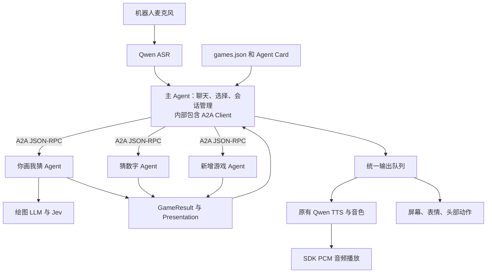

# 桌面机器人 Agent

主 Agent 负责语音聊天和游戏选择，通过 A2A 与独立游戏 Agent 通信。目前提供“你画我猜”和“猜数字”，游戏目录由 `games.json` 配置。

说“有哪些游戏”查看目录，说“开始猜数字”或“玩第二个”选择游戏。游戏期间可以聊天，说“继续游戏”恢复，也可以直接继续回答。聊天期间暂停游戏的静默计时。

同时只能运行一个游戏。说“结束游戏”退出，结束播报和设备操作完成后才能开始其他游戏。直接要求换游戏时，机器人会提示先退出当前游戏。

## 你画我猜

对机器人说“我们来玩你画我猜”开始。

- 每局 5 题，每题 2 次机会，答对得 1 分，同一局动物不重复
- 最近 72 小时出现过的动物、同义名称和相同图案不会重复，满 72 小时后可以再次出题；重启程序后仍然保留有效历史
- 答对时点头，答错时摇头，动作与反馈语音同时进行，完成后回到居中姿态
- 说“提示”要线索，每题 3 条，不占机会；第一次答错也会给一条
- 说“下一题”跳过，说“结束游戏”退出
- 连续 3 次、每次 20 秒没人说话，本局自动结束
- 画图要等一会儿，这段时间可以随便聊天，聊天不算答题

机器人说话和执行答题反馈动作时不收音，语音与动作都完成后恢复收音。

## 猜数字

机器人随机选择 1 到 20 的整数，玩家有五次回答机会。回答后会告知数字过大或过小；说“提示”可以获得奇偶信息。答对或机会用完后结束，也可以随时说“结束游戏”。

## 运行

需要 Python 3.11+、[uv](https://docs.astral.sh/uv/)，以及一台和电脑在同一局域网的机器人，固件支持 `expression.runtime.v3`、`expression.vector_accessory.v1`、`microphone`、`audio.stream`、`motion`。

```bash
cp .env.example .env              # 填入 API key
uv sync
uv run watcherobot robot setup    # 仅首次连接设备
uv run watcherobot app run .
```

按 Ctrl+C 或执行 `uv run watcherobot app stop` 停止。

## 配置

配置写在 `.env` 里，同名环境变量优先。各项含义见 `.env.example` 的注释：

| 变量 | 用途 |
| --- | --- |
| `DASHSCOPE_API_KEY` | 语音识别和语音合成（阿里云百炼 Qwen-Audio） |
| `TYPESAFE_API_KEY` | Jev，判断玩家说的是指令、答案还是闲聊 |
| `LLM_API_KEY` | OpenAI 兼容接口，主 Agent、画图和猜数字语言理解共用 |
| `GAME_CATALOG` | 游戏目录 JSON 路径，默认项目中的 `games.json` |

`DASHSCOPE_BASE_URL` 是百炼业务空间的地址，换 key 时记得一起改。

## 闲聊和画图模型

闲聊和画图共用 `LLM_PROVIDER` 和 `LLM_MODEL_NAME`，使用相同的接口地址、凭据和请求参数：

| 值 | 说明 |
| --- | --- |
| `openai`（默认） | 通过 OpenAI SDK 调用兼容 Chat Completions 的接口 |
| `claude_code` | 本机 `claude --print`，用 CLI 已登录的账号 |
| `codex` | 本机 `codex exec`，同上 |

OpenAI 兼容接口只需填写同一组变量，例如：

```dotenv
LLM_PROVIDER=openai
LLM_BASE_URL=https://api.deepseek.com
LLM_API_KEY=填写你的密钥
LLM_MODEL_NAME=deepseek-flash
LLM_EXTRA_BODY_JSON={"thinking":{"type":"enabled"},"reasoning_effort":"low"}
```

更换服务时，将 `LLM_BASE_URL`、`LLM_API_KEY`、`LLM_MODEL_NAME` 改成目标服务的配置。接口需要支持 JSON 对象输出。`LLM_EXTRA_BODY_JSON` 默认是 `{}`，用于填写所选服务支持的可选参数，如思考模式、输出长度或服务等级。它不能覆盖模型、消息和响应格式。`LLM_TIMEOUT_SECONDS` 控制单次调用超时，默认 180 秒。

使用本机 CLI 时，在启动游戏的电脑上安装对应 CLI，并在终端完成登录。
将 `.env` 中同名的六项变量替换为下面的一组，语音和 Jev 配置继续保留。

**Codex**：执行 `codex login` 登录，使用 `codex login status` 检查登录状态。

```dotenv
LLM_PROVIDER=codex
LLM_API_KEY=
LLM_BASE_URL=
LLM_MODEL_NAME=
LLM_EXTRA_BODY_JSON={}
LLM_COMMAND=codex
```

**Claude Code**：执行 `claude auth login` 登录，使用 `claude auth status` 检查登录状态。

```dotenv
LLM_PROVIDER=claude_code
LLM_API_KEY=
LLM_BASE_URL=
LLM_MODEL_NAME=
LLM_EXTRA_BODY_JSON={}
LLM_COMMAND=claude
```

`LLM_MODEL_NAME` 留空时，闲聊和画图均使用 CLI 默认模型；填写时通过 `--model` 指定。切换到 CLI 时，将接口模式下的模型名称清空，`LLM_EXTRA_BODY_JSON` 设为 `{}`。CLI 使用自己的登录凭据。

`LLM_COMMAND` 只填写可执行文件名称或绝对路径，不包含 `exec`、`--print` 等参数，程序会自动添加。留空时按 provider 使用 `codex` 或 `claude`。如果启动游戏时找不到命令，macOS/Linux 可用 `command -v codex` 或 `command -v claude` 查询绝对路径，Windows PowerShell 可用 `(Get-Command codex).Source` 或 `(Get-Command claude).Source`，将结果填入 `LLM_COMMAND`。

修改 `.env` 后重新启动游戏。`LLM_TIMEOUT_SECONDS` 同样控制 CLI 调用超时，可根据所用模型的耗时调整。

生成失败或超时会直接报错，不会自动换 provider。每次生成的 JSON 和去重记录存在 `.artifacts/`，重启后仍然有效。

## 测试

```bash
uv run pytest -q
uv run ruff check app.py robot_agents games scripts tests
uv run watcherobot app check .
```

默认执行 `tests/unit` 中的单元测试，使用真实题目和音频样本，覆盖游戏规则、提示顺序、图案校验、表情、音频处理及进程清理，不连接设备和模型服务。

E2E 会调用真实服务并产生费用。运行全部 provider 的比较测试时，使用 `LLM_PROVIDER=openai` 配置好接口，Claude Code 和 Codex 需要已经登录；测试使用两个 CLI 各自的默认模型，同时验证画图和闲聊。真机测试需要连接机器人并停止游戏，将机器人放在 Mac 电脑扬声器附近，确保它能清楚收录电脑播放的声音。

| 命令 | 检查内容 |
| --- | --- |
| `uv run pytest tests/e2e -m e2e -q` | 全部模型服务与真机 E2E |
| `uv run pytest tests/e2e/test_agents.py -m e2e -q` | 真实 A2A HTTP、本地与远程游戏注册、真实模型选择与聊天、单游戏限制、取消生成、完整五题、TTS → ASR → 主 Agent → 游戏 |
| `uv run pytest tests/e2e/test_services.py -m e2e -q` | 三个 provider 的生成、历史保存和聊天上下文、Jev 分类、流式 TTS 与连续 ASR |
| `uv run pytest tests/e2e/test_robot.py -m e2e -q` | 真机，仅 macOS：完整五题语音游戏、提示、表情、计分、跳题、交流、结束及音频资源释放 |
| `uv run pytest tests/e2e/test_robot.py -m e2e -k pcm_playback -q` | 真机：PCM 播放取消、再次播放和麦克风恢复 |
| `uv run pytest tests/e2e/test_robot.py -m e2e -k expression -q` | 真机：三轮十格进度、语音播放、九格等待、完成与取消、旧任务失效 |
| `uv run pytest tests/e2e/test_robot.py -m e2e -k answer_feedback -q` | 真机：答对点头、答错摇头、语音和表情同时反馈、动作取消与收音恢复 |
| `uv run pytest tests/e2e/test_services.py -m e2e -k codex -q` | 单独检查 Codex 绘图 |
| `uv run watcherobot app run scripts/eye_preview` | 真机：逐个预览眼型，不调模型 |

真机 E2E 通过电脑扬声器发声、机器人麦克风收音，调用生产应用流程。它检查提示、答题、表情、计分、跳题、游戏期间聊天、播报期间暂停收音，以及完整五题结束后选择猜数字、拒绝直接切换和退出游戏。随后检查取消播放、再次播放和麦克风恢复。A2A 测试单独验证生成期间退出、旧会话输入拒绝和同时开始两个游戏；注册测试对共享模块计算文件摘要，验证增加游戏配置前后共享代码完全相同。语音服务 E2E 还会持续发送 35 秒静音，再验证同一 ASR 会话识别两条独立语句。测试不使用 mock。

每次 E2E 的音频、应用日志和报告保存到 `.artifacts/tests/<测试名称>/<运行编号>/`。真机测试核对本次运行编号、应用退出状态和全部场景结果。可以追加 `--junitxml=.artifacts/tests/e2e.xml` 输出 JUnit 报告。设备未连接、模型失败、超时或断言失败都会使测试失败。图案检查覆盖格式、几何与设备确认，人眼辨识效果需要人工查看。

## 实现



主 Agent 使用 Pydantic 定义的结构化决策选择 `reply`、`list`、`start`、`send`、`resume`、`end` 或 `ignore`。A2A Client 直接执行决策。游戏接收用户原话和题目版本，维护自己的规则、模型上下文与分数。主 Agent 只读取公开状态。

本地游戏通过官方 `a2a-sdk` 启动仅监听 `127.0.0.1` 的 HTTP 服务，并通过 Agent Card 发现。普通请求返回结构化 Message；生成题目返回 A2A Task，完成时通过 artifact 交付结果，退出时取消任务。`context_id` 标识一局游戏，`request_id` 用于已完成请求的去重，`revision` 拒绝已经过期的题目输入。主 Agent 在输出完成前保留当前游戏的占用状态。

- **图案**：模型输出动物名、别名、3 条提示和笔画坐标，经 Pydantic 校验后用 SDK 的矢量配件逐笔显示。设备上限是 12 条笔画、192 个点。重名、提示里带答案、笔画和以前完全相同的结果都会被拒绝。
- **表情**：`robot_agents/assets/emojis/` 里的三个 SVG 转成白色矢量笔画，分别用于生成中、答对、答错。生成中的进度条分成十格，按 `DRAWING_ESTIMATE_SECONDS` 估算，每经过预计时间的十分之一增加一格，等待结果时最多显示九格。生成完成后显示满格，再绘制动物。每次进度变化使用 `expression_runtime.start()` 提交完整图案和显示参数，一次生成最多提交 11 个进度画面。`ProgressDisplay` 管理计时和任务标识，显示命令串行执行，退出后旧进度请求失效。
- **语音**：TTS 合成完整的 24 kHz、单声道、16-bit PCM，通过 SDK `audio.play_pcm()` 播放，等待设备确认结束后恢复麦克风。所有播报排队，互不打断；取消时停止设备播放。
- **出错**：网络、鉴权、设备或生成结果有问题时，直接退出并打印错误。

| 文件 | 职责 |
| --- | --- |
| `app.py` | SDK 入口 |
| `robot_agents/application.py` | 收音、ASR、主 Agent 与输出队列的运行周期 |
| `robot_agents/main_agent.py` | 主 Agent 决策、聊天历史、单游戏限制与 A2A Client 调用 |
| `robot_agents/transport.py` | 游戏注册、Agent Card、本地服务和 A2A HTTP 通信 |
| `robot_agents/protocol.py` | Pydantic 请求、结果、公开状态与设备输出 schema |
| `robot_agents/output.py` | 统一播报、屏幕、表情、动作与麦克风管理 |
| `games/guess_animal/agent.py` | 你画我猜入口 `GameAgent` |
| `games/guess_number/agent.py` | 猜数字入口 `GameAgent` |
| `games.json` | 游戏目录 |
| `games/guess_animal/game.py` | 出题、计分、提示 |
| `games/guess_animal/generator.py` | 提示词、输出校验、去重历史 |
| `games/guess_animal/animals.py` | 动物数据结构 |
| `games/guess_animal/judge.py` | Jev 意图和答案判定 |
| `robot_agents/providers.py` | OpenAI 兼容接口 / Claude Code / Codex 调用 |
| `robot_agents/vector.py` | 公共笔画结构和矢量编码 |
| `robot_agents/expressions.py` | 表情 SVG 转换和进度条 |
| `robot_agents/eyes.py` | 待机眼睛和眼型预览参数 |
| `robot_agents/conversation.py` | LLM 闲聊和上下文 |
| `robot_agents/speech.py` | Qwen ASR / TTS |
| `robot_agents/audio_stream.py` | SDK PCM 播放、完成确认和取消处理 |
| `robot_agents/microphone.py` | 麦克风收音和播报时静音 |
| `robot_agents/config.py` | 配置读取和检查 |
| `robot_agents/assets/emojis/` | 公共表情 SVG |
| `scripts/` | 眼型预览工具 |
| `tests/` | 单元测试、真实服务和真机 E2E |

## 添加游戏

每个游戏位于 `games/<game_id>/`，目录包含 `__init__.py`，统一入口文件为 `agent.py`，入口类为 `GameAgent`。游戏专用模块放在对应游戏目录内；公共语音、模型和显示能力位于 `robot_agents/`。新增游戏实现以下接口：

- `descriptor: GameDescriptor` 声明唯一 ID、名称、玩法描述、别名和设备能力。
- `__init__(settings)` 创建独立游戏状态与模型客户端。
- `async handle(request: GameRequest) -> GameResult` 处理 `start`、`input`、`timeout`、`end`，以及游戏需要的 `prepare`、`advance`。
- `async close()` 释放模型连接和游戏资源。

`GameResult.state` 描述阶段、状态、可用指令、版本和是否继续。需要语音、图案或动作时返回 `Presentation`。结束时设置 `active=false`，需要清除图案时返回 `clear=true`。游戏应校验输入版本；游戏认为某条输入属于聊天时返回 `handled=false`，由主 Agent 回复。

把模块加入 `games.json`，重新启动应用：

```json
{
  "kind": "local",
  "id": "guess_number",
  "factory": "games.guess_number.agent:GameAgent"
}
```

`games/guess_number/agent.py` 是完整示例。增加使用现有语音、屏幕和动作能力的游戏，只需要新增游戏目录和注册配置，主 Agent 的提示词、选择逻辑和输出处理自动使用游戏声明。

独立部署的游戏可以配置 `{"kind":"remote","id":"my_game","url":"https://example.com"}`。服务需要提供 A2A Agent Card、JSON-RPC 接口，以及 ID 对应且标记 `desktop-game/1` 的 skill。设备能力通过该 skill 的 `capability:motion` 等 tag 声明；请求与结果遵循 `robot_agents/protocol.py`。当前远程连接使用公开 HTTP/HTTPS 接口，认证由部署环境提供。

## License

MIT
