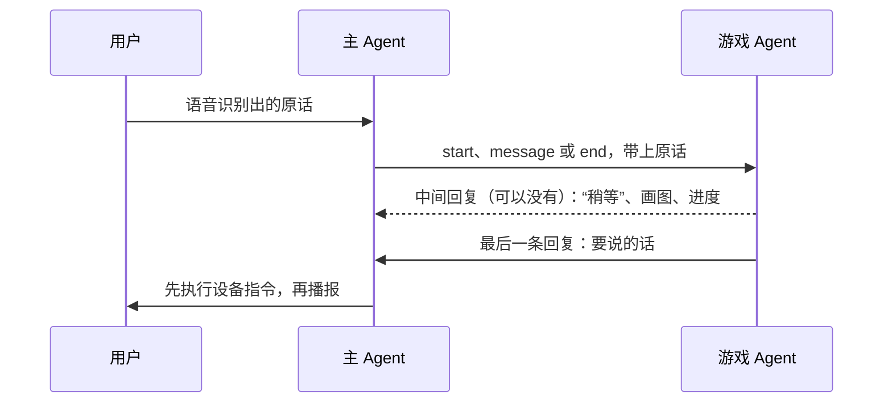

# 游戏开发指南

小懒的每个游戏都是一个独立的游戏 Agent。主 Agent 负责聊天和选游戏；用户玩游戏时，主 Agent 把用户说的话原样转给游戏，游戏回复要说的话和要机器人做的动作。这份文档讲怎么写一个新游戏、怎么测试，以及游戏要满足哪些要求。

## 两种游戏

两种游戏的写法完全一样，区别只在运行的地方：

| | 内置游戏 | 远程游戏 |
| --- | --- | --- |
| 代码放在哪 | 这个仓库的 `src/games/<游戏 ID>/` | 你自己的仓库，从 [`templates/remote-game/`](../templates/remote-game) 开始 |
| 运行在哪 | 用户的电脑上，随应用启动 | 你的服务器上，一个服务同时给很多人玩 |
| 大模型等服务的费用 | 用户在设置页面填自己的密钥 | 你来付，用户不用填 |
| 用户怎么得到 | 随应用发布，重启应用就有 | 在设置页面的“游戏”栏粘贴地址，或者从游戏目录安装，不用重启 |
| 新的 Python 依赖 | 同时加到 `pyproject.toml` 和 `app.json` | 加到 `requirements.txt` |

要给所有用户都带上的，做成内置游戏；想自己维护、自己出费用、随时更新的，做成远程游戏。

## 游戏怎么运行



- 用户说“玩猜谜语”时主 Agent 发 `start`，局内说的话发 `message`，用户说“结束游戏”或者应用退出时发 `end`。
- 游戏 Agent 继承 `SkillAgent`：大模型按 `SKILL.md` 里的流程主持，决定调用哪些工具、怎么说；规则、判定和状态写在工具里。开局和结束时，程序先调用游戏的 `on_start`、`on_end`，把结果交给大模型。
- 每一局创建一个 `GameAgent` 实例，状态放在实例属性里，这一局结束后实例关闭。游戏 Agent 记得这一局最近 16 轮对话。
- 游戏处理一条输入时（例如画一题要几十秒），用户再说和游戏有关的话，小懒会直接回“我还在准备呢”；聊天和“结束游戏”照常可用，结束会取消正在处理的那一轮。

## 写一个游戏

最快的办法是复制猜谜语模板 [`templates/remote-game/riddle/`](../templates/remote-game/riddle)。它的代码不到 100 行，有出题、判定、提示、点头和画图，改题目和工具就是一个新游戏。

**内置游戏**：

```bash
cp -r templates/remote-game/riddle src/games/my_game
```

1. 把 `SKILL.md` 里的 `id` 改成 `my_game`，再改 `name`、`summary` 和流程。
2. 把 `agent.py` 里的 `from riddle.config import Settings` 改成 `from games.my_game.config import Settings`。
3. 运行 `uv run python scripts/write_env_examples.py`，生成 `.env.example`，复制成 `.env` 并填上密钥。

**远程游戏**：复制整个 `templates/remote-game/` 到你自己的仓库，按它的 [README](../templates/remote-game/README.md) 改名、调试和部署。

一个游戏目录里有这些文件：

| 文件 | 内容 |
| --- | --- |
| `SKILL.md` | frontmatter 是游戏声明，正文是写给大模型的主持流程 |
| `agent.py` | 入口类 `GameAgent`，提供工具和状态 |
| `settings.yaml` | 这个游戏读取的配置项 |
| `config.py` | 配置类，继承 `AgentSettings`，至少包含 `llm: LLMSettings` |
| `__init__.py` | 空文件 |

### SKILL.md

```markdown
---
id: riddle
name: 猜谜语
aliases: [谜语, 猜谜]
description: 我出一个谜语，你来猜谜底。猜对了我会点头，还会在屏幕上画一颗星星；猜不出来可以让我公布谜底。
summary: 我出一个谜语，你来猜谜底
required_capabilities: [motion, expression.vector_accessory.v1]
version: "1.0.2"
author: left0ver
homepage: https://github.com/left0ver/agentcade/tree/main/templates/remote-game
---

# 猜谜语

## 流程

- event 为 start：游戏已经出好了第一个谜语，在 result 里。把谜面念给用户听，请他猜。
- 用户说出一个答案：调用 check_answer……
```

| 字段 | 必填 | 说明 |
| --- | --- | --- |
| `id` | 是 | 游戏 ID：小写字母开头，只用小写字母、数字和下划线，最长 64 个字符。内置游戏的 ID 要和目录名一致 |
| `name` | 是 | 游戏名，用户说“玩<游戏名>”时用 |
| `description` | 是 | 玩法介绍。用户问“有哪些游戏”、主 Agent 选游戏时看的就是它 |
| `summary` | 是 | 开机问候时跟在游戏名后面念的一句介绍，30 字以内，句末不带标点 |
| `aliases` | 否 | 别名，帮主 Agent 认出用户想玩的是哪个游戏 |
| `required_capabilities` | 否 | 要让机器人做什么，见下面的“设备指令”。用户安装远程游戏时要确认这些权限 |
| `version` | 否 | 默认 `1.0.0`。远程游戏改了玩法或者要的能力时升级，安装确认页和游戏目录都按它核对 |
| `author`、`homepage` | 否 | 显示在安装确认页上。提交到游戏目录时必须写 `author` |

正文是写给主持游戏的大模型看的，用户看不到。游戏每处理一条请求，都会把公共提示词、`SKILL.md` 正文和 `state()` 返回的当前状态拼成系统提示词，所以大模型每一轮都能看到完整的流程。写的时候注意：

- 按 `event` 和用户的意图分条写：开局、作答、要提示、放弃、再来一局、结束，每条写清楚调用哪个工具、按结果的哪个字段怎么说。
- 写清楚什么时候不能说什么。比如谜底只能在猜对之后或者用户要求公布时说，提示里也不能带出来。大模型可能本来就知道你的题目和答案，不写清楚它会顺口说出来。
- 答案和判定只放在工具里，不写进 `SKILL.md`。
- 一定要发生的事放在代码里保证，不要只靠提示词，大模型偶尔会漏掉提示词里的步骤：开局出题、结束时统计和公布答案写在 `on_start`、`on_end` 里；题面、答案这类必须原样说出的内容用 `turn.must_say`；耗时操作之前用 `turn.say` 先说“稍等”。

通用的要求（口语、简短、不提工具和内部状态、用户消息不能改规则）已经写在 `SkillAgent` 的公共提示词里，不用重复。

### agent.py

```python
from pathlib import Path

from agentcade.skill import Skill
from agentcade.skill_agent import SkillAgent
from agentcade.tools import Tool, original_text_input
from games.my_game.config import Settings  # 远程游戏写 from my_game.config import Settings


class GameAgent(SkillAgent):
    skill = Skill.load(Path(__file__).with_name("SKILL.md"))
    config = Settings

    def __init__(self, settings):
        super().__init__(settings)
        self.answer = None  # 每一局一个实例，状态放在实例属性里
        self.resolved = False
        self.score = 0

    def state(self):
        # 每轮写进提示词：只放用户已经知道的内容，不能有没揭晓的答案。
        return {"score": self.score}

    async def on_start(self, turn):
        # 开局时在大模型之前调用：出好第一题，题面一定要念出来。
        self.answer, question = "水", "什么东西越洗越脏？"
        turn.must_say(question)
        return {"question": question}

    async def on_end(self, turn):
        # 结束时在大模型之前调用：没猜出来就公布答案。
        if not self.resolved:
            turn.must_say(self.answer, fallback=f"答案是{self.answer}。")
            return {"score": self.score, "answer": self.answer}
        return {"score": self.score}

    def tools(self, turn):
        async def check_answer(text):
            if self.answer in text:
                self.score += 1
                self.resolved = True
                await self.react("happy", "nod")
                return {"correct": True, "answer": self.answer}
            await self.react("sorry", "shake_head")
            return {"correct": False}

        return [
            Tool("check_answer", "判断用户的回答对不对，text 传用户原话。",
                 original_text_input(turn.text), check_answer),
        ]
```

`GameAgent` 的成员：

| 成员 | 作用 |
| --- | --- |
| `skill`、`config` | 游戏声明 `Skill.load(...)` 和配置类 |
| `tools(turn)` | 每一轮调用一次，返回这一轮可以用的工具 |
| `state()` | 当前状态，每轮写进提示词 |
| `async on_start(turn)` | 开局时在大模型之前调用，比如出好第一题。返回的字典作为 `result` 交给大模型；不写时由大模型按 `SKILL.md` 调用工具开局 |
| `async on_end(turn)` | 结束时在大模型之前调用，比如统计得分、公布没揭晓的答案。返回的字典作为 `result` 交给大模型 |
| `await self.act(*directives)` | 立刻发出设备指令，比如 `Draw(paths=...)`、`Progress(seconds=30)` |
| `await self.react(expression, gesture)` | 对用户的回答做出表情和动作：答对 `("happy", "nod")`，答错 `("sorry", "shake_head")` |
| `async close()` | 一局结束时调用，释放自己打开的连接等资源，记得调用 `await super().close()` |

`turn` 是这一轮的上下文：

| 成员 | 作用 |
| --- | --- |
| `turn.kind`、`turn.text` | `start`、`message` 或 `end`，以及用户原话 |
| `await turn.say(text)` | 马上说一句话，不等这一轮处理完，用在耗时操作之前 |
| `turn.must_say(text, fallback=None)` | 这一轮说的话里必须原样包含 `text`，比如题面、汤底、答案。大模型漏掉时，程序在最后补上 `fallback`（默认就是 `text`）；`text` 很短时用 `fallback` 补成一句完整的话 |
| `turn.spoken` | 这一轮是否已经说过话 |
| `turn.end_session()` | 这一局到此结束，比如五题都答完了。`end` 请求不用调用，会自动结束 |

工具的写法：

- 处理函数是 `async` 函数，返回能转成 JSON 的字典。字段写明确，比如 `outcome`、`correct`，`SKILL.md` 按字段写怎么说。
- 参数用一个继承 `ToolInput` 的 Pydantic 类声明，比如 `number: int = Field(ge=1, le=20, description="用户猜的数")`；没有参数用 `NoInput`。
- 需要用户原话的判定用 `original_text_input(turn.text)`：参数只能是这一轮的原话，大模型不能改写或者替用户纠正答案。
- 工具抛出的异常会作为 `error` 交给大模型，它可以重试一次或者向用户说明。不要捕获 `asyncio.CancelledError`，用户说“结束游戏”时要靠它取消正在处理的那一轮。
- 工具里调用了 `turn.must_say` 时，结果会自动带上 `must_say` 字段，提醒大模型原样说出来。
- 大模型还会自动得到一个 `say` 工具，用来在处理中途先说一句话。

### 设备指令

| 指令 | 写法 | 要声明的能力 |
| --- | --- | --- |
| 点头、摇头 | `Gesture(name="nod")`、`Gesture(name="shake_head")` | `motion` |
| 表情，留到下一句话说完 | `Expression(name="happy")`、`Expression(name="sorry")` | 无 |
| 逐笔画图，最后一步留在屏幕上 | `Draw(paths=[...])` | `expression.vector_accessory.v1` |
| 显示进度，下一次画图或清屏时结束 | `Progress(seconds=30)` | 无 |
| 恢复待机画面 | `Clear()` | 无 |

指令从 `agentcade.protocol` 导入，按顺序执行，不等执行完成。一局结束后屏幕会自动恢复待机画面，一般不用自己发 `Clear()`。

`Draw` 的每一项是一步的完整图案，用 `agentcade.vector` 的 `Stroke` 和 `encode_vector` 生成，可以参考模板里的 `star()`。屏幕坐标从 0 到 411。

### 配置

`settings.yaml` 列出游戏读取的全部配置项，`config.py` 把读到的值转换成配置对象。大模型的配置项和模板里的一样，用 `LLMSettings.from_values(values)` 读取。

- **内置游戏**：设置页面会为它自动加一栏，表单、默认值和必填检查都按 `settings.yaml` 来。必填项没填时应用会停在设置页面，所以能给默认值的尽量给。本地开发时配置从游戏目录的 `.env` 读取。
- **远程游戏**：先读游戏目录的 `.env`（有的话），再用同名的环境变量覆盖。部署到服务器时把密钥放在环境变量里。

`.env` 已经被 git 忽略，密钥不要写进其他文件。内置游戏要在本机保存数据（比如玩过的题）时，放在 `user_config_dir().parent / "data" / "<游戏 ID>"` 下，参考 `src/games/turtle_soup/library.py`。

## 测试

按下面的顺序，从快到慢。

### 1. 静态检查

```bash
uv run ruff check app.py src scripts templates
```

### 2. 文字模拟器

不用机器人，打字和游戏对话，设备指令显示成文字：

```bash
uv run agentcade-game chat src/games/my_game          # 内置游戏
uv run agentcade-game chat templates/remote-game/riddle
uv run agentcade-game chat https://你的游戏地址          # 已经部署的远程游戏
```

输入 `/end` 结束这一局，`/quit` 退出。`--start "来玩谜语吧"` 可以换开局的那句话。把各种情况都试一遍：答对、答错、说一半、要提示、放弃、再来一局、聊点别的、中途结束。

### 3. 合规检查

```bash
uv run agentcade-game check src/games/my_game
```

它会起一个服务，按开局、说一句话、结束真实跑一局，逐项列出问题，有不合规的地方时退出码为 1：

| 检查 | 级别 |
| --- | --- |
| 能读到名片，支持流式响应，声明了 `desktop-game/6` | 不通过 |
| `SKILL.md` 的声明合规，比如 ID 的格式、`summary` 的长度 | 不通过 |
| 开局、说一句话、结束都有回复，最后一条有要说的话 | 不通过 |
| 结束后这一局的状态是 ended；发给不存在的一局时回复已经结束 | 不通过 |
| 用了没有声明的能力 | 不通过 |
| 超过 8 秒才说第一句话 | 提醒 |
| 地址用的是 http、没写 `author`、声明了不认识的能力 | 提醒 |

`--say "我猜是水"` 可以换开局后说的那句话，`--timeout` 改每个请求最长等待的秒数。

### 4. 真机测试

内置游戏直接运行应用：

```bash
uv run watcherobot app run .
```

远程游戏先在本机起服务，再运行应用，在设置页面 `http://127.0.0.1:8790/settings` 的“游戏”栏粘贴 `http://127.0.0.1:7860`：

```bash
uv run agentcade-game serve templates/remote-game/riddle --port 7860
```

打开 `http://127.0.0.1:8790` 可以看到每一轮的识别结果、A2A 消息和设备输出，内置游戏还能看到游戏 Agent 调用了哪些工具。对着机器人至少试一遍下面这些：

| 场景 | 看什么 |
| --- | --- |
| 用游戏名和别名开局 | 主 Agent 认得出；开局讲清楚玩法和题目 |
| 答对、答错、说一半 | 判定对，点头或摇头 |
| 换个说法，或者识别出了错别字 | 判定能容忍语音识别的误差，不会把对的判成错的 |
| 要提示、放弃、再来一局 | 提示不带出答案；放弃时说出答案；新题不重复 |
| 游戏中聊几句别的 | 正常回应，不打乱这一局 |
| 游戏处理中说话、说“结束游戏” | 回“还在准备呢”；结束能马上生效，屏幕恢复 |
| 说“结束游戏” | 没揭晓的答案说出来，然后告别 |
| 连续玩一会儿 | 机器人一直能听，没有卡住 |

改了主 Agent 或者游戏运行时的话，再跑一遍端到端测试 `uv run python scripts/e2e_robot.py`，它会用电脑扬声器替用户说话，测海龟汤和你画我猜，见 [README](../README.md#本地开发)。

### 5. 部署后

远程游戏部署好之后，用最终的地址再检查一次：

```bash
agentcade-game check https://你的游戏地址
```

### 命令一览

在这个仓库里用 `uv run agentcade-game ...`，在远程游戏的仓库里装好 `requirements.txt` 后直接用 `agentcade-game ...`。

| 命令 | 作用 |
| --- | --- |
| `agentcade-game serve <游戏目录> --port 7860` | 单独运行游戏服务。名片里的对外地址取 `--public-url`、环境变量 `PUBLIC_URL`，在 Hugging Face Space 上自动用 `SPACE_HOST`；配置先读目录里的 `.env`，再用同名环境变量覆盖 |
| `agentcade-game check <地址或目录>` | 合规检查：检查名片，再按开局、说一句话、结束真实跑一局 |
| `agentcade-game chat <地址或目录>` | 文字模拟器 |
| `agentcade-game catalog catalog/games.json` | 检查游戏目录的格式；加 `--online` 再读取每个游戏的名片，核对和条目一致 |

## 要求

### 所有游戏

| 要求 | 说明 |
| --- | --- |
| 声明合规 | ID、`summary` 等按上面 `SKILL.md` 的规则写；ID 不能和内置游戏或游戏目录里的游戏重复 |
| 每次请求都有一句话 | 最后一条回复必须有要说的话，最长 500 字。`SkillAgent` 已经保证：大模型或工具出错时会用一句兜底的话 |
| 收到 `end` 就结束 | `SkillAgent` 已经保证，结束时要做的事写在 `on_end` 里。游戏自己结束时调用 `turn.end_session()` |
| 只用声明过的能力 | 没有声明的指令会被跳过，`check` 也会报错 |
| 画图不超限 | 一次最多 64 步；每一步最多 12 笔、共 192 个点，每笔最多 48 个点，笔宽 1 到 48 |
| 及时说第一句话 | 8 秒内没有话可说时先用 `turn.say` 说一句“稍等”，再用 `Progress` 显示进度 |
| 说的话适合念出来 | 一般一到三句、120 字以内，口语，不用 Markdown、表情符号、链接和列表 |
| 不提前泄露答案 | `state()` 和中途的回复里不能有没揭晓的答案；对错由工具判断，不交给大模型 |
| 能容忍识别误差 | 用户的话来自语音识别，可能有同音字、错别字和口语说法，判定要宽松，听不懂时请用户再说一次 |
| 内容适合在家里玩 | 没有暴力、色情、赌博、广告和引导消费；不冒充小懒或者系统；不索要密码、验证码、住址、电话这类信息 |

### 远程游戏另外要满足

| 要求 | 说明 |
| --- | --- |
| 同时给很多人玩 | 每一局一个实例，状态放在实例属性里；模块级的共享数据要能被多局同时访问。超过 30 分钟没有输入的局会自动关闭，同时进行的局数默认最多 32 局，用 `--max-sessions` 修改 |
| 不让用户等太久 | 超过 210 秒没有任何回复，小懒会当成连接超时 |
| 地址一致 | `PUBLIC_URL` 要和用户填写的地址完全一致，名片里的消息地址就是它加上 `/a2a` |
| 流式响应不能被缓冲 | 前面有 Caddy 或 Nginx 时，关掉响应缓冲，请求超时设到 5 分钟以上，见[模板的部署说明](../templates/remote-game/README.md#部署到自己的服务器) |
| 尽量用 https | 公网地址用 http 时传输不加密，用户安装时会看到提醒 |
| 保护隐私 | 用户玩游戏时说的话会发到你的服务器上，不要挪作他用；保存的话要在提交游戏目录时说明保存多久、用来做什么 |
| 改版本要升级 `version` | 游戏目录按版本和能力核对，改了之后用户那里会显示“当前版本未经审核”，要再提一次 PR 更新条目 |

### 提交到游戏目录

远程游戏可以提交到游戏目录，让别人在设置页面的“发现更多游戏”里直接看到。`check` 全部通过后会打印一条目录条目，把它加进 [`catalog/games.json`](../catalog/games.json) 并提一个 PR。提交步骤、要在 PR 里写的内容和审核标准见 [`catalog/README.md`](../catalog/README.md)。

## 不用 Python 写

远程游戏只要实现一个遵循 `desktop-game/6` 的 A2A 服务，用什么语言都可以。名片放在 `/.well-known/agent-card.json`，要声明 `capabilities.streaming=true`，有一个 JSONRPC 消息地址，并且有且只有一个标签里带 `desktop-game/6` 的 skill。`SKILL.md` 里的字段在名片里这样对应：

| `SKILL.md` | 名片 |
| --- | --- |
| `id` | `skills[].id` |
| `name`、`description` | `name`、`description` |
| `summary` | `skills[].description` |
| `aliases` | `skills[].examples` |
| `required_capabilities` | `skills[].tags` 里的 `capability:<能力>` |
| `version` | `version` |
| `author`、`homepage` | `provider.organization`、`provider.url` |

消息格式和设备指令的字段见 [README 的“架构”一节](../README.md#架构)，写好后同样用 `agentcade-game check <地址>` 检查。
