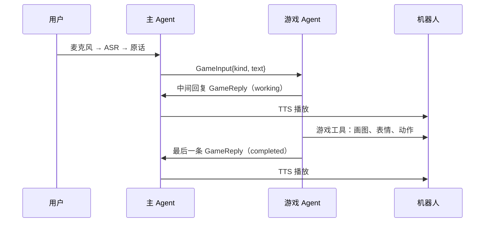

# 主 Agent 与游戏 Agent 通信设计

## 职责

主 Agent 通过机器人麦克风和 ASR 取得用户原话，直接回答普通聊天，或者调用 `list_games`、`start_game(game_id)`、`end_game`、`send_message(text)`。游戏相关的输入原样转给游戏 Agent，游戏 Agent 的回复经 TTS 由机器人播放。

每个游戏 Agent 是一个由 `SKILL.md` 驱动的 ReAct Agent：`SKILL.md` 规定规则和整体流程，模型按流程调用游戏自己的工具。规则、状态、判定、计分和设备操作都在游戏 Agent 内部，主 Agent 只知道当前在玩哪个游戏、这一局是否还在继续。

## 通信格式 `desktop-game/5`

主 Agent 发一条消息，游戏 Agent 把它当作用户输入，回复一条或多条要播报的话。两个方向都用 A2A 的 DataPart 承载 JSON，模型定义在 `robot_agents/protocol.py`。

主 Agent → 游戏 Agent（`GameInput`）：

```json
{"protocol": "desktop-game/5", "kind": "message", "text": "我猜10"}
```

| 字段 | 说明 |
| --- | --- |
| `kind` | `start` 开局，`message` 局内输入，`end` 结束本局 |
| `text` | 用户原话，保持字词和标点；程序退出时发送的 `end` 可以为空 |

游戏 Agent → 主 Agent（`GameReply`）：

```json
{"protocol": "desktop-game/5", "text": "比十还大一些，你还有四次机会。", "session": "active"}
```

| 字段 | 说明 |
| --- | --- |
| `text` | 1 至 500 字，主 Agent 原样播报 |
| `session` | `active` 表示本局继续，`ended` 表示本局结束；只有一次请求的最后一条回复可以是 `ended` |

## A2A 映射

| 方向 | A2A 载体 |
| --- | --- |
| 主 → 游戏 | 流式 `SendMessage`，`Message` 的 `context_id` 标识一局游戏，`message_id` 是请求 ID，`parts` 是一个 `GameInput` |
| 游戏 → 主，中间回复 | `TaskStatusUpdateEvent`，状态 `working`，`status.message.parts` 是一个 `GameReply`，零到多条 |
| 游戏 → 主，最后一条回复 | `TaskStatusUpdateEvent`，状态 `completed`，`status.message.parts` 是一个 `GameReply`，恰好一条 |
| 出错 | Task 进入 `failed`，主 Agent 向用户说明并继续运行 |

一次请求至少有一条回复。回复是不是最后一条由 Task 状态决定。Agent Card 声明 `streaming=true`，skill 的 ID 是游戏 ID，标签包含 `desktop-game/5` 和 `capability:<设备能力>`，`examples` 是游戏别名。



## 游戏 Agent

`robot_agents/skill_agent.py` 的 `SkillAgent` 是所有游戏共用的运行时，子类提供三样东西：

| 成员 | 作用 |
| --- | --- |
| `skill` | `Skill.load("SKILL.md")`，frontmatter 是游戏声明，正文是规则和流程 |
| `tools(turn)` | 这个游戏的工具 |
| `state()` | 当前状态快照，每轮写入系统提示词，不能包含未揭晓的答案 |

处理一条输入时，系统提示词由公共提示词、`SKILL.md` 正文和状态快照组成，用户消息是 `{"event": kind, "user_text": text}`。模型可以连续调用工具，最终文本作为最后一条回复。本局的对话保留最近 16 轮。

`turn` 提供 `kind`、`text`、`say(text)` 和 `end_session()`。运行时内置 `say` 工具，模型在耗时操作之前用它先说一句话，这句话立刻作为中间回复发给主 Agent。游戏自然结束时工具调用 `turn.end_session()`；收到 `end` 的那一轮结束后，本局一定结束。

| 游戏 | 工具 |
| --- | --- |
| 你画我猜 | `start_game`、`get_hint`、`submit_answer(text)`、`skip_question`、`next_question`、`end_game`、`show_drawing`、`show_progress` |
| 猜数字 | `start_game`、`get_hint`、`submit_guess(number)`、`end_game` |
| 公共设备工具 | `show_expression(expression)`、`move_head(gesture)`、`clear_display` |

动物答案由 JEV 判定，`submit_answer` 只接受用户完整原文，每条输入只判一次。设备工具通过构造时注入的设备执行函数直接操作机器人，执行完成后返回 `device_completed=true`。

游戏服务按到达顺序逐条处理同一局的请求。`end` 到达时取消正在处理的那一轮，再执行结束流程。

## 出错处理

每次请求都要有一条可以播报的回复，出错时也一样。

| 情况 | 处理 |
| --- | --- |
| 工具参数不合法或执行失败 | 结果以 `{"error": ...}` 交还给模型，由它重试或向用户说明 |
| 游戏 Agent 的模型出错或没有给出回复 | 回复兜底的话，这一轮不写入记忆；`start` 和 `end` 同时结束本局 |
| 收到 `start` 时上一局还在 | 关闭上一局，直接开始新的一局 |
| 收到 `message` 或 `end` 时这一局已经不存在 | 回复 `session` 为 `ended` 的提示，主 Agent 据此清除会话 |
| 请求本身失败（网络错误、Task `failed`） | 主 Agent 提示用户；`start` 和 `end` 清除会话，`message` 保留会话 |

## 主 Agent

`start_game` 建立新的 `context_id` 并发送 `start`，`send_message` 发送 `message`，`end_game` 取消未完成的请求后发送 `end`，三者都携带用户原话。

发送后主 Agent 在后台读取回复流。每条回复排队播报，播完写入历史，角色为 `game_agent`。第一条回复播完这一轮就结束，麦克风恢复收音；其余回复到达后继续播报。最后一条回复的 `session` 为 `ended` 时清除当前游戏。

游戏还在处理上一条输入时，`send_message` 不再转发，主 Agent 请用户稍等；聊天和 `end_game` 不受影响。

## Trace

trace 记录用户输入、主 Agent 和游戏 Agent 的工具调用、A2A 请求、每一条回复、播报文本和设备执行。游戏侧的记录通过请求 ID 归入发起请求的那一轮。已完成的 A2A Task 默认保留最近 64 个。
