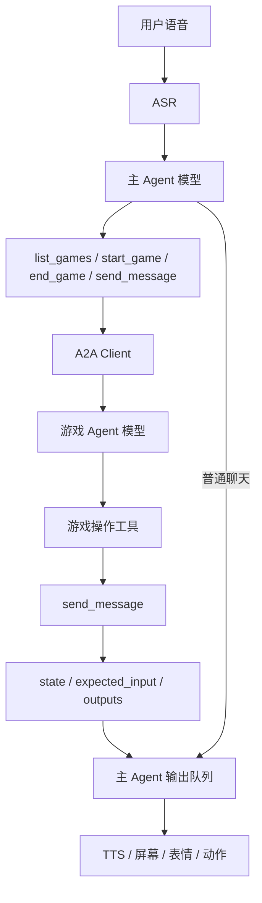

# 主 Agent 与游戏 Agent 通信设计

## 模型与工具

主 Agent 使用 `robot_agents/main_agent.py` 注册的四个工具选择游戏、管理会话和发送消息。普通聊天由主 Agent 直接回答。游戏 Agent 通过自己的工具处理规则、出题、提示、回答、计分和结束。

`robot_agents/tools.py` 保存工具名称、描述、Pydantic 输入模型和执行函数。输入模型直接生成 JSON Schema。工具执行前校验参数，执行错误向调用方传播。每次调用记录名称、参数和结果，保存在 Agent 的 `last_tool_calls` 中。

OpenAI 兼容接口使用 Chat Completions 的 `tools`、`tool_calls` 和 `tool` 消息执行工具循环。Claude Code 和 Codex 通过官方 Python MCP SDK 连接当前进程的工具服务。服务仅监听 `127.0.0.1` 的随机端口，使用每次生成的随机路径，调用结束后关闭。CLI 仅启用本次 Agent 的 MCP 工具。

## 主 Agent 工具

所有输入 schema 都是 JSON object，`additionalProperties` 为 `false`。无参数工具使用 `{"type":"object","properties":{},"additionalProperties":false}`。

| 名称 | 描述 | 输入 |
| --- | --- | --- |
| `list_games` | 列出游戏 ID、名称、介绍、别名和设备能力 | 无参数 |
| `start_game` | 建立会话，发送 A2A `start` | `game_id: string`，必填且非空 |
| `end_game` | 取消未完成的请求，发送 A2A `end` | 无参数 |
| `send_message` | 将用户完整原文发送为 A2A `input` | `text: string`，必填且非空 |

`game_id` 必须来自已注册游戏；`text` 必须与本轮用户输入完全一致。`context_id`、`request_id` 和 `revision` 由运行程序管理。主 Agent 每轮最多执行一次会话操作，同时最多保持一局游戏。游戏相关工具的返回值包含 `delivered`、`state` 和 `expected_input`。游戏反馈已经进入输出队列后，主 Agent 不重复播报。

## 你画我猜工具

| 名称 | 描述 | 输入 |
| --- | --- | --- |
| `start_game` | 初始化五题游戏并生成第一题 | 无参数 |
| `get_rules` | 查询规则 | 无参数 |
| `get_game_state` | 查询进度、得分和下一步输入要求 | 无参数 |
| `get_hint` | 返回下一条提示，更新提示记录 | 无参数 |
| `submit_answer` | 判定动物答案，更新得分、机会和题目状态 | `text: string`，必填且必须为用户完整原文 |
| `skip_question` | 公布当前答案并生成下一题；最后一题结束整局 | 无参数 |
| `next_question` | 当前题目结束后生成下一题 | 无参数 |
| `end_game` | 结束游戏并返回得分 | 无参数 |
| `send_message` | 发送操作产生的消息、图案和动作，可补充说明 | 公共消息输入 |

`submit_answer` 内部使用 JEV 判定动物名称及别名。提示、跳题等工具由游戏 Agent 的模型选择。绘图生成继续使用独立的结构化输出与校验。生成期间通过 A2A 状态事件报告进度，并允许查询规则和状态。`end` 请求会取消未完成的生成与模型调用。题目结束后等待用户说下一题；最后一题结束时返回整局得分。

## 猜数字工具

| 名称 | 描述 | 输入 |
| --- | --- | --- |
| `start_game` | 随机选择秘密整数，初始化五次机会 | 无参数 |
| `get_rules` | 查询规则 | 无参数 |
| `get_game_state` | 查询次数和下一步输入要求 | 无参数 |
| `get_hint` | 返回秘密整数的奇偶提示 | 无参数 |
| `submit_guess` | 判断猜测大小，更新机会和游戏状态 | `number: integer`，必填，范围 1 至 20 |
| `end_game` | 结束游戏 | 无参数 |
| `send_message` | 发送操作反馈，可补充文字、表情和动作 | 公共消息输入 |

公共消息输入：

```json
{
  "type": "object",
  "additionalProperties": false,
  "properties": {
    "text": {"type": "string", "maxLength": 500, "default": ""},
    "expression": {"anyOf": [{"type": "string", "enum": ["happy", "sorry", "thinking"]}, {"type": "null"}], "default": null},
    "gesture": {"anyOf": [{"type": "string", "enum": ["nod", "shake_head"]}, {"type": "null"}], "default": null}
  }
}
```

操作工具产生的图案、答案反馈和动作保存在当前请求中。模型调用 `send_message` 时一并发送；`text` 留空即可保留完整原文。游戏状态和下一步输入要求由游戏代码生成，每次回复均包含。

## A2A 消息

应用数据协议为 `desktop-game/3`，请求位于 A2A Message 的 DataPart 中，使用 `start`、`input`、`end` 三种 action。A2A `context_id` 标识游戏会话。以下为猜数字输入的应用数据示例：

```json
{
  "protocol": "desktop-game/3",
  "request_id": "request-002",
  "action": "input",
  "text": "我猜10",
  "revision": 1
}
```

游戏回复的 `state` 和 `expected_input` 均为必填字段。示例中的数值由当前游戏决定：

```json
{
  "protocol": "desktop-game/3",
  "state": {
    "phase": "等待猜测",
    "status": "已经猜了1次，剩余4次机会。",
    "commands": ["猜一个1至20的整数", "提示", "结束游戏"],
    "revision": 2,
    "active": true,
    "details": {"attempts": 1, "remaining_attempts": 4}
  },
  "expected_input": {
    "kind": "answer",
    "description": "请猜一个1至20的整数，也可以请求提示或结束游戏。",
    "examples": ["我猜10", "给我提示", "结束游戏"]
  },
  "outputs": [{"text": "猜小了，还有4次机会。", "expression": "sorry", "gesture": "shake_head"}]
}
```

`expected_input.kind` 支持 `answer`（等待回答）、`command`（等待下一题等指令）、`wait`（正在生成）和 `none`（已经结束）。`description` 解释输入要求，`examples` 提供示例。游戏代码避免在公开状态中包含秘密答案。

主 Agent 保存游戏回复，在下一轮模型请求中提供 `state` 和 `expected_input`。`state.details` 支持嵌套 JSON 数据，可以包含棋盘、玩家列表和其他游戏状态。新的游戏能够使用自己的状态字段和输入说明。新增游戏只需注册并遵循公共 A2A 格式。

## 输出与会话



每个请求使用 A2A Task，进度通过状态事件发送，最终结果通过 artifact 返回。`request_id` 用于请求去重，`revision` 用于拒绝过期输入。语音开始时间关联当时的会话和已经展示的题目版本。结束反馈展示完成后，主 Agent 清除会话。

等待用户输入期间保留游戏状态，没有回答计时提醒或自动结束。每个本地游戏服务保留最近 64 个已结束 A2A Task；进行中的任务继续保留。调用错误直接传播，失败不会被标记为成功。

## 验证

单元测试检查工具输入、必填回复字段、游戏规则和配置。真实服务测试检查三种 provider 的工具调用记录、A2A 注册、请求去重、普通聊天、单游戏限制、取消生成、过期输入以及完整五题。运行记录保存在 `.artifacts/tests/`。
